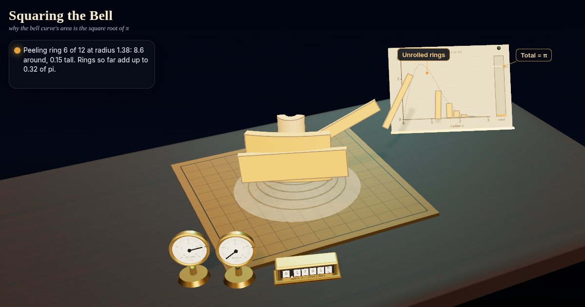

# Squaring the Bell: why the bell curve's area is the square root of pi

No ordinary formula gives the bell curve's area. So build a 3D bell hill and weigh it twice: cut into slabs it holds area x area, peeled into rings it holds exactly pi. Same hill, so the area is the square root of pi.



**Live demo:** https://interesting-x.scorpion-labs.com/gaussian-integral/

Inspired by a bookmark from [@Math_files](https://x.com/Math_files/status/2105779801718132927).

Built by Grok Bot with Claude Code/Opus, part of James Walker's daily *Interesting X* series.

## Run locally

```bash
npm install
npm run dev      # then open the printed URL (served under /gaussian-integral/)
npm run build    # static output in dist/
```

## License

MIT © 2026 James Walker
